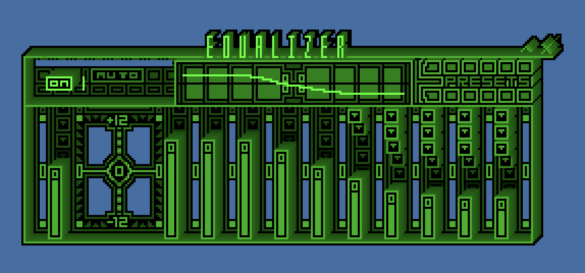

# Turn up the music — player research and design decisions

Research date: 2026-11-06. This is a reinterpretation of tactile desktop/music interfaces, not an imported Winamp implementation or a literal skin copy.

## Evidence inspected
| Reference | Evidence and limits |
| --- | --- |
| [Winamp desktop documentation](https://support.winamp.com/winamp-desktop-player-for-windows) | First-party documentation describes transport, playlist, equalizer and classic/modern skin support, including both music and video. It is current documentation spanning later desktop versions; it is not presented as a 1997 screenshot. |
| [Webamp preservation project](https://github.com/captbaritone/webamp) and [skin documentation](https://docs.webamp.org/docs/features/skins/) | The project documents its effort to preserve Winamp 2 skins, including pixel-level classic rendering. This supports the historic importance of a player as a customisable personal object. No dependency or code from Webamp is added here. |
| [Webamp equalizer documentation](https://docs.webamp.org/docs/features/equalizer/) | The illustrated example shows tightly packed tactile controls, a distinctive display and a skinned technical faceplate. The actual EQ implementation described there is not implemented or claimed by Stan Army. |
| [Winamp Skin Museum](https://skins.webamp.org/) | Inspected as an archive/preservation lead. Its JS-driven gallery was not fully available to the text tool; no claim of individually inspecting its entire collection. No skin file is downloaded or reused. |
| [UC Press chapter, Music as a Digital File](https://content.ucpress.edu/chapters/13039.ch01.pdf), especially pp. 54–58 | Retrospective scholarship discusses visualisations, tactile playback metaphors, modular windows and user skins. Useful interpretation of historical experience, not a contemporary period capture. |
| [boyd, MySpace observations, February 2006](https://www.danah.org/papers/talks/AAAS2006.html) and the [2007 profile screenshot already inspected](MYSPACE_2003_2008.md) | Music belongs inside a personal social space alongside expression and conversation. That supports an immediately usable music object rather than a promotional artist masthead. |

### Inspected preservation-reference image

Source: [Webamp's exact documentation image](https://docs.webamp.org/assets/images/equalizer-skin-664931adc37bb602f20904b3e91e6fa1.png). Research reference only, with no reusable skin-art licence claimed; not imported into the product. This is a current preservation-documentation screenshot, not an asserted original-period capture.

## Interpretation applied to Nova
- Make the player a little machine somebody would choose to keep around: a title strip, readable track display, real transport controls, tactile buttons, optional queue and a compact/expanded state.
- Preserve control semantics across skins. Classic desktop, Bubblegum Y2K, Quiet hours and Toxic chrome are original local CSS treatments with fixed safe palettes. They do not change what Play, Pause, seek or volume mean.
- Music/video are two modes of one player. Video gets a larger surface in the same page; the listening room and video shelf reuse the component instead of growing competing players.
- Start with actual original demo audio so the one-stan case has something to play. No sample is labelled as a Nova release or commercial recording.
- Keep movement honest. Decorative pixels react to the local playback state but are not an audio spectrum/EQ. They are labelled accordingly, optional and covered by motion preferences. No fake DSP or synchronized listening claim.
- Remove the oversized Nova promotional banner. A compact identity, player and immediately following participation are the arrival sequence. Saved custom banners remain as a small readable identity background rather than being deleted.

## Implementation and limits
The original instrumental sketches are generated from mathematical oscillators, envelopes and simple pulse patterns; the reproducible source is `scripts/create-demo-audio.py`. The catalogue also includes the two existing original silent videos and the existing approved NPR/YouTube example. Playback is user-initiated and individual. Local transport controls use HTML media events and properties; the provider iframe uses its own controls after explicit consent, with a fallback link.

Skins are an additive validated v1 theme field. Old colours, backgrounds, fonts, panels, decorations and images remain; missing player settings receive a safe default. Only the existing authorised community-role simulation opens the editor. No autoplay, new streaming infrastructure, music licensing service, public uploads, account system, payments or deployment is added.
