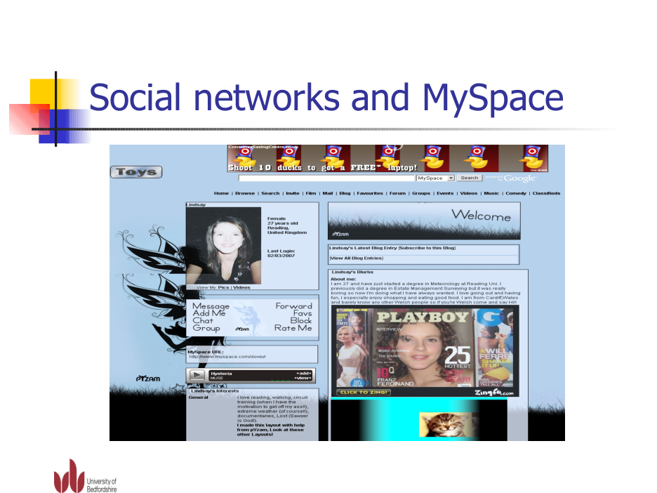

# Research: a space somebody has been here before you

Research date: 2026-11-06. Focus requested: original MySpace, 2003–2008. Accessible primary evidence here is strongest for 2006–2007; do not treat modern recreations as original captures or extrapolate every feature across the whole period.

## Historical evidence
| Source and status | What it supports |
| --- | --- |
| [danah boyd, AAAS talk, 19 February 2006](https://www.danah.org/papers/talks/AAAS2006.html) — contemporary field observation | Profiles combined interests, photos/music/video, public comments and a visible friend network. Returning to messages/comments was part of ordinary use; people could express themselves and answer one another. |
| [Hugo Liu, 2007, Social Network Profiles as Taste Performances](https://onlinelibrary.wiley.com/doi/full/10.1111/j.1083-6101.2007.00395.x) — contemporary empirical study | Self-described interests, profile choices and displayed relationships expressed identity/taste. Its Figure 1 documents a profile layout retrieved in June 2007. |
| [Peter Godwin, INFORUM 2007 presentation, slide 23](https://www.inforum.cz/pdf/2007/godwin-peter1.pdf#page=23) — contemporary visual capture | A personalised blue profile combines decorative foreground/background, an embedded music player, photo/video links, personal writing and blog entries beneath recognisable platform navigation. It visibly separates shared service structure from a member's authored surface. |
| [boyd & Ellison, 2007, Social Network Sites: Definition, History, and Scholarship](https://www.danah.org/papers/JCMCIntro.pdf) — contemporary research synthesis | Visible connections and comments are central social structures; the MySpace discussion describes personalisation and a copy/paste culture around backgrounds/layouts. This supports member expression, not copying unsafe HTML today. |
| [Henrik Nyh, 6 December 2006, MySpace CSS odds and ends](https://thepugautomatic.com/2006/12/myspace-css-odds-and-ends/) — firsthand technical account | Members changed framing and image separators with CSS, despite difficult markup. The author also criticises usability: expression did not guarantee a good experience. |

### An actual period screenshot inspected

Rendered directly from the original presentation's PDF page 23, inspected at readable resolution. Research quotation only; no claim of a reusable asset licence. Not imported into the product, no original MySpace branding/layout/code copied. The slide includes a third-party member profile and period advertising, which are historical evidence rather than recommendations.

### Supplied leads and access limits
- [SpaceHey archive collection](https://forum.spacehey.com/topic?id=243227&sort=new): inspected as a **modern index** pointing to dated snapshots, not primary historical evidence itself.
- [Tom archive, 11 April 2006](https://web.archive.org/web/20060411024614/myspace.com/tom) and [decorated profile, 20 October 2007](https://web.archive.org/web/20071020033525/http://profile.myspace.com/index.cfm?fuseaction=user.viewprofile&friendid=5504028): attempted; archive replay was inaccessible to the research tool. No claim of having seen those archived pages or captured screenshots of them.
- [Tom recreation repository](https://github.com/wittenbrock/toms-myspace-page) and [rendered recreation](https://wittenbrock.github.io/toms-myspace-page/): inspected. Useful secondary reconstruction of contact actions, interests, blog links, friends and visible comments. It is **not** an original 2006 screenshot. No source or graphic was copied.

## Interpretation for Stan Army — design hypotheses, not historical facts
The useful inheritance is authorship plus reciprocity. A single stan needs somewhere to put a thought, a way to make that contribution feel personal, and an invitation for the next person to answer. Crowd statistics, fake activity and layers of random graphics cannot supply that.

- **A contribution should change the place.** Add a note and it visibly joins the same feed; replies attach to it. Nothing silently pretends to publish globally.
- **Let authors have different handwriting.** Restrained notebook, after-hours text, plain note and photo-memory compositions share usable controls without forcing every contribution into identical editorial cards.
- **Show relationships as people, not metrics.** A small fictional cast has interests and names; no fabricated online indicator or competitive leaderboard.
- **A small object can hold a shared memory.** A blurry photo, original desk print, fictional ticket or cassette becomes a visual shoebox. Captions and provenance prevent stock examples being mistaken for real uploads.
- **Put the artist first, the community next.** Nova remains the hero. The fan feed is the main body. The founder receives a warm credit near the bottom rather than an oversized promotional panel.
- **Give quiet rooms a purpose.** Show only the first stan's note and a visitor can still write, style, keep something and reply. There is no empty dashboard demanding that an audience arrive first.

## Applied prototype changes
Prominent working note composer with prompts and four controlled treatments; session-local notes/hearts/replies; a sample-conversation toggle that leaves a first-stan feed; visual gallery previews leading to a filtered gallery/lightbox/local keepsake shelf; two original playable silent typography videos; a small member orbit; understated founder thanks. Core chat/music/events, separate community/official announcements, ownership, theme storage, clean view and pause controls remain.

These are a proposed reinterpretation, not a MySpace clone or a validated engagement result. All fictional participation is labelled. No real uploads, copyrighted performances, backend, billing or hosting were added. Product screenshots/browser layout checks remain limited by unavailable managed browser tooling; the research screenshot above is a separate accessible historical artifact.
